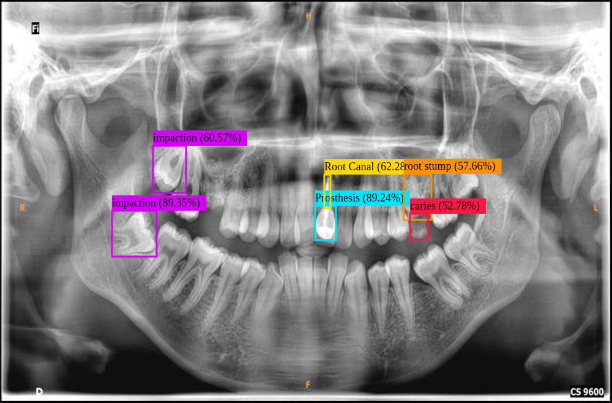

# TeethXrayAI
A computer vision project for AI teeth xray analysis. This repo features a YOLO26 object detection model trained on the [panoramic dental dataset](https://universe.roboflow.com/panoramicmetaldetection/dental-iyn0e) (CC BY 4.0) and a simple web interface for querying it.
If you dont want to selfhost it then you can use my personal deployment https://xray.cyphersec.eu/

The model detects 6 classes on panoramic xrays: Prosthesis, Root Canal, caries, impaction, restoration and root stump.



## Content
1. Self hosting
2. Training
3. Evaluation

## Self Hosting
The trained YOLO26m model ships in the root of this repo as `best.pt`. If you train your own, replace `best.pt` with it (or point the `MODEL_PATH` environment variable at it). Then run
```
python3 -m pip install -r requirements.txt
```
followed by
```
python3 object_detector.py
```
This should make the UI available on http://127.0.0.1:8080
## Training Proccess
For training i used the YOLO package from the python ultralytics libary. Luckily this makes the training fairly easy.
Step 1: Head over to roboflow and create an account. Download version 1 of https://universe.roboflow.com/panoramicmetaldetection/dental-iyn0e in YOLO26 format, either from the website or with the roboflow python package:

```
pip3 install ultralytics roboflow
```
```python
from roboflow import Roboflow
rf = Roboflow(api_key="YOUR_API_KEY")
rf.workspace("panoramicmetaldetection").project("dental-iyn0e").version(1).download("yolo26", location="dental-data")
```
Step 2: train from the pretrained YOLO26m weights. Early stopping ended this run at epoch 88 (best epoch 58) after 22 minutes on an RTX 5090:

```
yolo train data=dental-data/data.yaml model=yolo26m.pt epochs=150 patience=30 imgsz=640 batch=32 cache=ram seed=0
```
The model will be saved in runs/detect/train/weights/best.pt.
## Evaluation
Metrics of the included `best.pt` on the held-out test split (`yolo val split=test`):
```
Ultralytics 8.4.220 🚀 Python-3.12.3 torch-2.15.0+cu132 CUDA:0 (NVIDIA GeForce RTX 5090, 32109MiB)
YOLO26m summary (fused): 130 layers, 20,354,078 parameters, 0 gradients, 68.1 GFLOPs
                 Class     Images  Instances      Box(P          R      mAP50  mAP50-95)
                   all        284       1213      0.686      0.715      0.713      0.474
            Prosthesis         91        184      0.845      0.935      0.948      0.799
            Root Canal         94        238      0.672      0.758      0.723      0.361
                caries        106        209      0.526      0.321      0.346      0.118
             impaction        139        349      0.804      0.874      0.888      0.709
           restoration         58        154      0.788      0.857      0.871      0.543
            root stump         38         79      0.483      0.544      0.502      0.316
```
Caries is the weakest class by far, so treat caries detections with extra caution.

This is a research/demo project and not a medical device: do not use it for diagnosis.
